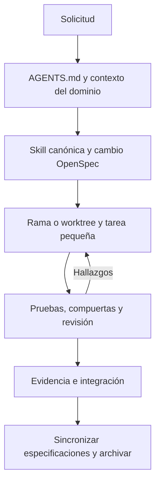

# Arnés de desarrollo de Coursegen

Estado: vigente. Actualizado: 2026-10-15.

El arnés adapta el patrón de SofLIA Hub al monorepo Courseforge. Proporciona
instrucciones, herramientas, entorno, estado y feedback para agentes de desarrollo.

## Fuentes y flujo

- AGENTS.md enruta; docs/standards conserva las 17 áreas de ingeniería.
- [system-context.md](system-context.md) conserva el contexto operativo previo.
- ai-specs/skills contiene procedimientos del proceso y de APIs/jobs, tenancy y multimedia.
- ai-specs/agents/registry.json vincula roles con fuentes y skills; no otorga permisos.
- openspec conserva contexto, alcance, diseño, escenarios, tareas y evidencia.
- Git conserva código e historial; worktrees aíslan cambios.
- Los adaptadores Codex/Claude/Antigravity son wrappers ordinarios generados.

## Comprobaciones

[Sincronizador](../../scripts/ai/sync-agent-adapters.mjs): genera wrappers sin
symlinks, compara contenido normalizado y rechaza huérfanos sin eliminarlos.
[Validador](../../scripts/quality/validate-harness.mjs): rutas, estándar, registro,
referencias, workflows y archivos locales modificados fuera de alcance.
[Enlaces](../../scripts/quality/check-doc-links.mjs): catálogo nuevo completo y
enlaces nuevos respecto a la base de comparación en documentos existentes. Los enlaces históricos
no modificados quedan fuera de esa compuerta; tampoco comprueba anclas ni web.
[Pruebas](../../scripts/quality/harness.test.mjs): repositorios temporales para
casos positivos y negativos, sin tocar el checkout de la persona.

verify:harness ejecuta adaptadores, estructura, enlaces, OpenSpec y pruebas del
arnés. verify:pr añade npm run verify. Se conserva la verificación existente de
lint, tipos, ciclos, migraciones, seguridad, audio y cobertura de dominios.
El [CI](../../.github/workflows/quality.yml) mantiene además compliance, QA
visual, pruebas nativas, build y audit. Ningún paso del arnés habilita publicación.

## Fronteras

El arnés no ejecuta un modelo, no inicia subagentes automáticamente y no implementa
equipos runtime dentro de Lia o los agentes multimedia. Los permisos siguen en el
host de desarrollo y en los servicios de producto. Las skills no se empaquetan
ni se cargan en rutas runtime por este cambio.

La disciplina documental y una comprobación estructural no prueban la calidad
semántica de un requisito. Las suites locales no prueban servicios cloud ni SQL
remoto. La obligación de una compuerta para fusionar requiere protección de rama
del proveedor Git; no se configura remotamente en esta entrega.

Ver [operación](../operations/harness-quickstart.md),
[procedencia](../references/harness-sources.md) y
[cambio/evidencia](../../openspec/changes/adapt-coursegen-harness/tasks.md).
